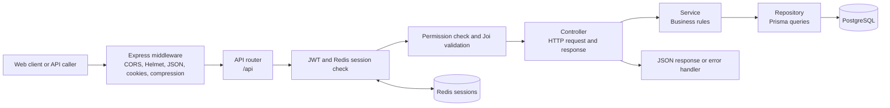

# Inventory Management System Backend — Presentation Guide

## 1. Project overview

This is the server-side application for an Inventory Management System (IMS). It exposes a JSON REST API for user access, roles and permissions, branch inventory, item requests and approvals, asset transfers, procurement requests, and maintenance incidents.

The backend is built with Node.js and Express. Prisma is the database layer, PostgreSQL stores the business records, and Redis stores login sessions. The application uses a modular structure so that HTTP routes, business rules, and database queries are kept in separate files.

## 2. How a request moves through the system



In plain language: a route receives the request, middleware checks it, the controller calls the service, the service applies the rules, and the repository reads or changes PostgreSQL through Prisma. The controller returns a JSON result. Errors go through one shared error handler.

## 3. How the backend starts

1. `npm start` runs `src/server.js`; `npm run dev` runs the same entry point with Nodemon reloads.
2. `src/config/env.js` loads environment variables and checks that the database URL and JWT secrets exist.
3. `src/app.js` creates the Express app and registers middleware, API routers, Swagger, the health endpoint, and the error handlers.
4. `src/server.js` connects Prisma to PostgreSQL. It starts listening only after the database connection succeeds.
5. On shutdown, the server stops accepting requests and disconnects Prisma.

Redis is used for login sessions. If Redis is unavailable, the current code falls back to an in-memory store; this fallback is useful for local development but is not shared between server processes.

## 4. Project structure and the main code

| Location | What it does |
| --- | --- |
| `src/server.js` | Connects to the database, starts the HTTP listener, and handles graceful shutdown. |
| `src/app.js` | Builds the Express application and mounts middleware, routes, docs, health, and error handling. |
| `src/config/` | Loads environment settings and configures database logging, Redis, security, and Swagger. |
| `src/database/prisma/schema.prisma` | Defines PostgreSQL models, relations, enums, and generated Prisma client behavior. |
| `src/database/prisma/seeds/permissionSeeder.js` | Creates permission and role records, branches, and optional demo users. |
| `src/modules/users/` | Authentication, user profiles, roles, permissions, and third-party user data. |
| `src/modules/inventory-management/` | SKU and asset inventory, requisitions, approvals, dispatch, procurement, and maintenance. |
| `src/shared/middleware/` | Reusable authentication, authorization, validation, request logging, and error middleware. |
| `src/shared/services/audit/` | Writes audit events for selected business actions. |
| `src/shared/utils/` | Shared response formats, errors, JWT helpers, validation helpers, and async wrappers. |

### Important file responsibilities

- `src/app.js`: applies Helmet security headers, CORS, JSON/form parsing, cookie parsing, compression, and development request logging. It mounts the user and inventory routers below `/api` and Swagger at `/docs/inventory`.
- `src/shared/middleware/authentication.js`: reads the access token from a cookie or `Authorization: Bearer ...`, verifies it, looks up the session, then attaches the user and permissions to the request.
- `src/shared/middleware/authorization.js`: checks whether the logged-in user has a named permission such as `INVENTORY.UPDATE`.
- `src/shared/middleware/validation.js`: validates the selected request body, route parameters, or query using Joi and returns a standard validation error when input is invalid.
- Controllers such as `src/modules/users/controllers/userController.js`: translate HTTP input into service calls and format successful responses.
- Services such as `src/modules/inventory-management/services/requisitionService.js`: apply business rules such as finding approvers and advancing a request through approval steps.
- Repositories such as `src/modules/inventory-management/repositories/requisitionRepository.js`: contain Prisma database operations.

## 5. Database concepts

The Prisma schema defines the main records and how they relate:

- **Identity and access:** `User`, `Role`, `Permission`, `Branch`, and `ThirdPartyMeta`.
- **Stock and assets:** `Category`, `SkuVariant`, `Asset`, `Location`, `GatePass`, and `ConsumableLog`.
- **Requests and approvals:** `Requisition`, `ApprovalStep`, `Procurement`, and `Signature`.
- **Maintenance and history:** `IncidentReport`, `AuditLog`, and `Document`.

A `SkuVariant` describes a stock item and its category. Serialized or individually tracked physical items are represented by `Asset` rows. Quantity-based issues are recorded in `ConsumableLog` and decrement the SKU's `current_stock`. A requisition belongs to a requester and SKU, and can have ordered approval steps. A gate pass records an asset movement between two locations.

The code uses integer IDs for roles, permissions, branches, categories, and locations. Users, assets, requisitions, gate passes, and other business records use UUIDs. `role_rank` is ordered with lower numbers representing higher authority in the requisition approval logic.

## 6. Login, sessions, and permissions

1. `POST /api/auth/login` checks the Fayda ID and password. Passwords are stored as bcrypt hashes.
2. The backend creates a Redis session with the user's role, branch, and permission codes.
3. It signs a short-lived access JWT and a longer-lived refresh JWT. Tokens are set as HTTP-only cookies; the access token is also returned in the response body for clients that use bearer headers.
4. Protected routes verify the access JWT and find the session in Redis before continuing.
5. `requirePermission('INVENTORY.UPDATE')`, for example, checks the permissions cached in the session.
6. Refresh rotates the refresh token. Logout verifies a signed token before deleting its session. Password, role, and permission changes revoke affected sessions so cached access does not continue with old permissions.

The demo seeder grants different permission sets to administrator, director, team leader, storekeeper, maintenance, employee, and third-party roles. Login is rate-limited to 10 attempts per IP over 15 minutes.

## 7. Main business workflows

### Requisition and approval

An employee creates a request. The service finds approvers based on the requester's role rank and branch, creates ordered `ApprovalStep` rows, and stores a bcrypt hash of a six-digit pickup OTP. Approvers act one step at a time. The request becomes `APPROVED` after its final step.

### Dispatch

A storekeeper verifies the OTP. For a consumable, the backend checks and decrements quantity and records a `ConsumableLog`. For an individually tracked item, it checks that the selected asset belongs to the requested SKU and is available, then assigns it to the requester. Serialized items also require a signature record. The requisition and stock or asset update run inside a database transaction.

### Transfer

A storekeeper starts a transfer with source and destination location IDs. The asset must be in the source location and in store. The backend marks it `IN_TRANSIT` and creates a gate pass. Receipt uses the destination stored on that gate pass; it does not trust a new destination supplied by the receiving client.

### Procurement and maintenance

An approved requisition that cannot be fulfilled from stock can become a procurement request for approval. A user can report a lost or damaged asset; the reporter's clearance flag is suspended until resolution. Maintenance permissions control the queue, resolution, and scrap actions.

## 8. API routes

The API base is `/api`. Protected endpoints accept the access token in the HTTP-only cookie or as `Authorization: Bearer <access-token>`. Unless stated otherwise, successful endpoints return `{ success, message, data, timestamp }`.

### Health and authentication

| Method | Route | Access | Purpose |
| --- | --- | --- | --- |
| `GET` | `/health` | Public | Health status, server time, and uptime. |
| `POST` | `/api/auth/login` | Public; rate-limited | Log in with `fayda_id` and `password`. |
| `POST` | `/api/auth/refresh-token` | Refresh token | Rotate tokens using the refresh cookie or a `refreshToken` body field. |
| `POST` | `/api/auth/logout` | Public endpoint; a signed access or refresh token deletes the matching server session | Clear cookies; without a valid token, no server session can be identified. |

### Users

| Method | Route | Permission | Purpose |
| --- | --- | --- | --- |
| `POST` | `/api/users` | `USERS.CREATE` | Create a user. Body: `fayda_id`, `email`, `password`, `full_name`, numeric `roleId`; optional `branch_id`, `user_type`, `supervisor_id`. |
| `GET` | `/api/users` | `USERS.READ` | List users. Supports `page`, `limit`, `search`, `roleId`, `branchId`, `userType`, and `suspended`. |
| `GET` | `/api/users/stats` | `USERS.READ` | Count users, clearance-suspended users, and users by type. |
| `GET` | `/api/users/hierarchy` | `USERS.READ` | List directors and higher roles with supervisor IDs. |
| `GET` | `/api/users/supervisor` | Authenticated | Get the current user's supervisor or third-party sponsor. |
| `GET` | `/api/users/profile` | Authenticated | Get the current user's profile. |
| `GET` | `/api/users/:id` | `USERS.READ` | Get a user by UUID. |
| `PATCH` | `/api/users/:id` | `USERS.UPDATE` | Update profile, role, branch, user type, supervisor, or clearance suspension. |
| `DELETE` | `/api/users/:id` | `USERS.DELETE` | Delete a user. |
| `POST` | `/api/users/change-password` | Authenticated | Change the current user's password using `currentPassword`, `newPassword`, and `confirmPassword`. |

### Roles and permissions

| Method | Route | Permission | Purpose |
| --- | --- | --- | --- |
| `POST` | `/api/roles` | `USERS.CREATE` | Create a role using `role_name`, integer `role_rank`, and optional `permissionIds`. |
| `GET` | `/api/roles` | `USERS.READ` | List roles with pagination and optional search. |
| `GET` | `/api/roles/:id` | `USERS.READ` | Get a role by integer ID. |
| `PATCH` | `/api/roles/:id` | `USERS.UPDATE` | Update a role name or rank. |
| `DELETE` | `/api/roles/:id` | `USERS.DELETE` | Delete a role if no users are assigned to it. |
| `POST` | `/api/roles/:id/permissions` | `USERS.UPDATE` | Assign permission IDs to a role. |
| `DELETE` | `/api/roles/:id/permissions` | `USERS.UPDATE` | Remove permission IDs from a role. |
| `POST` | `/api/permissions` | `USERS.CREATE` | Create a permission with a code such as `INVENTORY.READ`. |
| `POST` | `/api/permissions/bulk` | `USERS.CREATE` | Create up to 100 permissions in one request. |
| `GET` | `/api/permissions` | `USERS.READ` | List permissions, optionally filtered by module or search. |
| `GET` | `/api/permissions/module/:module` | `USERS.READ` | List permissions for a module. |
| `GET` | `/api/permissions/:id` | `USERS.READ` | Get a permission by integer ID. |
| `DELETE` | `/api/permissions/:id` | `USERS.DELETE` | Delete a permission. |

### Inventory, requests, approvals, and dispatch

| Method | Route | Permission | Purpose |
| --- | --- | --- | --- |
| `GET` | `/api/inventory/summary` | `INVENTORY.READ` | Get stock summary and low-stock flags. |
| `GET` | `/api/inventory/branch/:id` | `INVENTORY.READ` | Get stock associated with a branch ID. |
| `POST` | `/api/inventory/register` | `INVENTORY.UPDATE` | Register a SKU. Body includes `sku_id`, `item_name`, `cat_id`, and `threshold_qty`; stock and capacity are optional. |
| `POST` | `/api/inventory/transfer` | `INVENTORY.UPDATE` | Transfer an asset using `asset_id`, `from_loc_id`, and `to_loc_id`. |
| `PUT` | `/api/inventory/receive` | `INVENTORY.UPDATE` | Receive a transfer using `pass_id` and optional `receiver_sig`. |
| `POST` | `/api/requests/ask` | `REQUISITIONS.CREATE` | Request a SKU using `sku_id` and optional `quantity` (defaults to 1). Returns a one-time pickup OTP after request creation. |
| `GET` | `/api/requests/my-requests` | `REQUISITIONS.READ` | List the current user's requests. |
| `GET` | `/api/requests/approved-list` | `REQUISITIONS.READ` | List approved requests for the current user's branch. |
| `GET` | `/api/approvals/pending` | `REQUISITIONS.APPROVE` | List requests awaiting the current user's approval. |
| `POST` | `/api/approvals/:id/action` | `REQUISITIONS.APPROVE` | Approve or reject using `action` (`APPROVE` or `REJECT`) and an optional rejection `reason`. |
| `POST` | `/api/dispatch/verify-otp` | `REQUISITIONS.FULFILL` | Verify `req_id` and six-digit `otp`; include `asset_id` for individually tracked items. |
| `POST` | `/api/dispatch/notify` | `REQUISITIONS.FULFILL` | Mark an approved request ready for pickup. Notification delivery is currently a placeholder. |
| `GET` | `/api/dispatch/gate-pass/:id` | `REQUISITIONS.FULFILL` | Get a transfer gate pass by UUID. |
| `POST` | `/api/dispatch/sign` | `REQUISITIONS.FULFILL` | Save a signature for an approved request using `req_id` and `signature_blob`. |

### Procurement and maintenance

| Method | Route | Permission | Purpose |
| --- | --- | --- | --- |
| `POST` | `/api/procurement/buy-request` | `REQUISITIONS.FULFILL` | Create a procurement request for an approved, under-stock requisition using `req_id`. |
| `POST` | `/api/procurement/gd-approve/:id` | `REQUISITIONS.APPROVE` | Approve a pending procurement request by UUID. |
| `GET` | `/api/procurement/pending` | `REQUISITIONS.APPROVE` | List pending procurement requests. |
| `POST` | `/api/incidents/report` | `INVENTORY.READ` | Report `DAMAGED` or `LOST`, using exactly one of `asset_id` or `sys_id`. Users can report their own held assets; inventory managers can report other assets. |
| `GET` | `/api/maintenance/queue` | `INVENTORY.SCRAP` | List unresolved incidents. |
| `PUT` | `/api/maintenance/resolve/:id` | `INVENTORY.SCRAP` | Resolve an incident with `REPAIRED` or `SCRAPPED` and optional `notes`. |
| `POST` | `/api/maintenance/scrap/:id` | `INVENTORY.SCRAP` | Mark an asset UUID as scrapped. |

Swagger UI is served at `/docs/inventory/`; its OpenAPI JSON is at `/docs/inventory/json`.

## 9. Common response examples

Successful API response:

```json
{
  "success": true,
  "message": "Requisition created successfully",
  "data": {
    "req_id": "<generated UUID>",
    "status": "PENDING_APPROVAL"
  },
  "timestamp": "<ISO timestamp>"
}
```

Validation or application error response:

```json
{
  "success": false,
  "message": "Validation failed",
  "statusCode": 400,
  "timestamp": "<ISO timestamp>",
  "errors": [
    { "field": "quantity", "message": "..." }
  ]
}
```

## 10. Node.js, modules, and the libraries

### Node.js in simple terms

Node.js is the runtime that runs JavaScript outside a web browser. Here it runs the API server, handles HTTP requests, and performs database and Redis work asynchronously. Express is the web framework used on top of Node.js.

This project uses **ES modules**: `package.json` sets `"type": "module"`, source files use `import`, and local imports include `.js` extensions. A module is a file or package that exposes code for other files to import. For example, `userService.js` exports service logic, while `userRepository.js` imports Prisma and exports database operations.

There are three useful module groups:

- **Built-in Node modules:** `crypto` for secure random values and hashing helpers, `path` for file paths, and `url` for module file URLs.
- **Local project modules:** files under `src/`, organized by config, shared utilities, and business domain.
- **npm packages:** external libraries installed under `node_modules/` and declared in `package.json`.

### Main npm packages

| Package | Simple explanation and use here |
| --- | --- |
| `express` | Creates the HTTP server, routes, and middleware pipeline. |
| `@prisma/client` / `prisma` | Prisma provides the generated database client and schema/migration commands for PostgreSQL. |
| `pg` | PostgreSQL driver package; Prisma is the active database access layer in this application. |
| `bcrypt` | Hashes passwords and pickup OTPs so the original values are not stored directly. |
| `jsonwebtoken` | Signs and verifies access and refresh JWTs. |
| `ioredis` | Connects to Redis for session storage. |
| `joi` | Checks request input before controllers call business logic. |
| `express-rate-limit` | Limits repeated login attempts. |
| `helmet` | Adds HTTP security headers. |
| `cors` | Controls which browser origins may call the API. |
| `compression` | Compresses eligible HTTP responses. |
| `morgan` | Logs HTTP requests in development. |
| `winston` | Provides application logging. |
| `swagger-jsdoc` / `swagger-ui-express` | Builds and serves interactive OpenAPI documentation. |
| `dotenv` | Loads local `.env` configuration. |
| `nodemon` | Restarts the server during local development. |
| `eslint` / `prettier` | Check JavaScript quality and formatting. |

`express-session`, `connect-redis`, and `yamljs` are installed but are not used by the current request flow. Authentication uses JWT plus the project's own `sessionRepository` wrapper around Redis. There is no file-upload route or upload middleware in the current API.

## 11. Local setup and commands

1. Install Node.js and PostgreSQL. Redis is optional for a single-process local demo because an in-memory fallback exists.
2. Run `npm install`.
3. Copy `.env.example` to `.env`. Set `DATABASE_URL`, `JWT_SECRET`, `JWT_REFRESH_SECRET`, and `CORS_ORIGIN` for the local environment. Never commit `.env`.
4. Sync the local database schema with `npm run db:push`, or create and apply a migration with `npm run migrate`.
5. Run `npm run generate` after schema changes to generate Prisma Client.
6. To create demo roles and users, set `SEED_DEFAULT_PASSWORD` to a unique value of at least 12 characters, then run `npm run seed`. The seeder uses this password for all demo users; it does not use a built-in default password.
7. Start development mode with `npm run dev`, or production mode with `npm start`.

| Command | Purpose |
| --- | --- |
| `npm run dev` | Run the API with Nodemon. |
| `npm start` | Start the API server. |
| `npm run db:push` | Apply the current Prisma schema directly to a development database. |
| `npm run migrate` | Create/apply a development migration. |
| `npm run migrate:prod` | Apply checked-in migrations in production. |
| `npm run generate` | Regenerate Prisma Client from the schema. |
| `npm run seed` | Create/update permissions, roles, branches, and demo accounts. |

The repository currently has no checked-in `prisma/migrations` history. Before production deployment, create and review a baseline migration with `npm run migrate`, commit that migration, and then use `npm run migrate:prod` in deployment.

## 12. Review findings addressed

- Fixed request validation so Joi validates the correct body, parameter, or query object.
- Aligned user, role, and permission database queries and IDs with the actual Prisma schema.
- Added validation and permission checks to inventory, request, approval, dispatch, procurement, and maintenance write routes.
- Added the missing `IN_TRANSIT` asset status used by transfers and changed receipt to use the stored gate-pass destination.
- Fixed dispatch category lookup and made request/stock/asset changes transactional to prevent duplicate dispatch.
- Made approval updates transactional and prevented duplicate approval or rejection actions.
- Fixed maintenance's missing Prisma import and restricted incident reports for assets to their holder or an inventory manager.
- Used cryptographic randomness for pickup OTPs and removed OTP values from audit metadata.
- Verified signed tokens during logout, added login rate limiting, tightened CORS defaults, and gave the in-memory Redis fallback session expiry behavior.
- Changed API projections to omit password hashes and software license keys from nested user and asset responses.
- Made the seed password configurable and added `.env` ignore rules.
- Corrected the Swagger API base URL and added the route inventory to the OpenAPI document.

## 13. Items to know before presenting or deploying

- Dispatch notifications are currently logged but no SMS, email, or push provider is connected.
- Third-party contract-expiration handling exists as a service but is not scheduled or exposed by a route.
- The in-memory Redis fallback is process-local and should not be used for multiple production server instances.
- The schema has been updated with the `IN_TRANSIT` enum value. Apply a database schema update before running the transfer workflow.
- The repository has no automated test suite or test script. Static review in this pass used ESLint and Prisma schema validation; no tests were run.
- The `Documents` model and some helper services are not currently exposed as API routes.

## 14. Short presentation script

“This project is the backend API for an inventory management system. It uses Node.js with Express to receive requests, PostgreSQL to store users, stock, assets, requests, approvals, and audit records, and Prisma as the database layer. Users sign in with Fayda ID and password; bcrypt verifies passwords, JWTs identify the session, and Redis stores session permissions. The API is split into user and inventory modules. Each request passes through authentication, permission checks, and Joi validation before the controller calls a service and repository. The system supports inventory visibility, multi-step requisitions, OTP-protected dispatch, gate-pass transfers, procurement approval, and maintenance reporting.”

